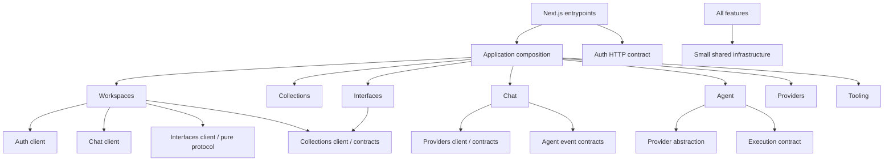

# PAW architecture

PAW is organized into vertical features under `apps/web/src/features`. Next.js entrypoints in `apps/web/app` delegate to feature contracts and the application composition root. This refactor preserves API URLs, persistence, the official A2UI v0.9.1 protocol, model defaults, credential encryption, and the discovery-first execution algorithm.

## Directory overview

Before:

```text
apps/web/app/
  workspace.tsx             # auth, workspace state, navigation, developer tools
  chat.tsx                  # conversations, transport, thread, composer
  renderer.tsx              # records, forms, charts
  a2ui-runtime.tsx, interface-builder.tsx, ai-settings.tsx
  globals.css, api/[...path]/route.ts
apps/web/lib/               # API client, auth database client, agent host
packages/
  core/services.ts          # all domain persistence operations
  core/schema.ts
  agent/                    # providers, settings, credentials, orchestration
  tools/definitions.ts      # all domain tools
  tools/                    # generic execution and domain resource graph
  conversations/, a2ui/
```

After:

```text
apps/web/app/
  page.tsx, layout.tsx, globals.css, api/[...path]/route.ts
apps/web/src/
  composition/
    Dashboard.tsx            # page composition
    services.ts              # request-scoped feature service assembly
    tools.ts, mcp.ts          # authoritative registration and host policy
    resources.ts             # cross-feature paw:// relationships
    http.ts, tool-http.ts     # endpoint routing and tool-host boundary
    agent-host.ts            # provider/executor/persistence wiring
  features/
    auth/                    # account UI, auth client and HTTP flows
    workspaces/              # shell, sidebar, settings, dialogs, loading, CRUD
    collections/             # records, validation, tables/forms/charts, CRUD, tools
    interfaces/              # official runtime, builder, revisions, bindings, tools
      protocol/              # isolated @paw/a2ui workspace, catalog and legacy reads
    chat/                    # conversations, messages, drafts, transport, streaming UI
    agent/                   # turn lifecycle, context, journal, dispatch and bounds
    providers/               # contracts, settings UI, keys, registry and SDK adapters
    tooling/                 # generic registry, discovery adapter and execution
  shared/
    db/                      # user/privileged client creation, checked errors
    http/                    # fetch client, origin checks, request/response contracts
    ui/, styles/, validation/
tests/                       # cross-feature contracts, integration and browser tests
scripts/check-boundaries.mjs
supabase/migrations/         # unchanged
```

There are no retained global service/component packages or forwarding files at the old paths. `@paw/a2ui` remains a private npm workspace **inside Interfaces**. Its separate package boundary preserves the existing pinned Zod 3.25.76 / official A2UI package compatibility; application and tool schemas use the existing Zod 4 installation. No protocol replacement or dependency upgrade is involved.

## Ownership and contracts

| Feature     | Authoritative responsibility                                                                                                            | Public contract                                           |
| ----------- | --------------------------------------------------------------------------------------------------------------------------------------- | --------------------------------------------------------- |
| Auth        | Email auth, sessions, account presentation                                                                                              | `client.ts`, `server/public.ts`                           |
| Workspaces  | Workspace CRUD and ownership lookup; workspace shell/state                                                                              | `public.ts`, `client.ts`, `server/public.ts`              |
| Collections | Field/data validation, collection/record CRUD, filtering, pagination, aggregation, collection tools                                     | `public.ts`, `client.ts`, `server/public.ts`              |
| Interfaces  | Official catalog/protocol, legacy reads, rendering/actions, builder, revision validation and persistence, interface tools               | `public.ts`, `client.ts`, `server/public.ts`              |
| Chat        | Conversation/message persistence and navigation, history pagination, draft/composer state, AI SDK React transport                       | `public.ts`, `client.ts`, `server/public.ts`              |
| Agent       | Context/prompt, bounded inference steps, cancellation, trusted event journal, discovery enforcement, repetition and mutation protection | `public.ts` event contracts, `server/public.ts` execution |
| Providers   | Provider contracts/adapters, models, metadata validation, encrypted credentials/preferences, AI settings/model selector                 | `public.ts`, `client.ts`, `server/public.ts`              |
| Tooling     | Generic typed registration/execution, schema validation, permissions, confirmation, MCP adapter                                         | `public.ts` types, `server/public.ts` infrastructure      |

Exports are explicitly named. `public.ts` contains client-safe data/contracts; `client.ts` exposes UI and browser behavior; `server/public.ts` exposes guarded server capabilities. A client must never import a server entrypoint. Imports within a feature may use its internal modules. Cross-feature imports use these explicit entrypoints, rather than reaching into another feature's hooks or services.

`WorkspaceService` implements only workspace operations. `CollectionService` receives a narrow workspace-authorization contract. `InterfaceService` receives workspace access and collection lookup. `createWorkspaceServices` binds these independently owned operations into one request-scoped host capability set; it contains no duplicate database rules. It is the stable runtime composition consumed by tools and HTTP routing, rather than a legacy implementation at a deleted path.

Workspace reads intentionally use Interfaces' **pure protocol/legacy conversion** contract to preserve the original read compatibility behavior. Interfaces' server implementation receives workspace access by injection; it does not construct workspace services. This avoids a runtime import cycle. Some domain contracts have type-only relationships in both directions; the runtime graph remains acyclic.

## Dependency direction



The diagram groups client and server contracts for readability; it does not imply that server modules import the client UI. The executable check in `scripts/check-boundaries.mjs` defines the permitted feature edges and scans imports/re-exports/dynamic imports. It rejects private cross-feature imports, upward imports from shared or features into composition, runtime cycles, unguarded server implementations, and transitive client paths into server modules. Type-only imports are excluded from the runtime graph.

Tooling and Providers do not import Agent, Workspaces, Collections, or Interfaces. Agent consumes only provider and execution abstractions; selecting concrete adapters happens in composition. The resource graph belongs to composition because `paw://` resource descriptions link multiple features. It delegates all reads and writes to the feature services; generic MCP code receives host-selected resource templates and the same executor.

## Runtime workflow and security boundaries

The route entrypoint validates origin/content type/body size, obtains the cookie-backed database client, verifies the user, dispatches, and converts results/errors to HTTP responses. Auth, workspace, collection, interface, conversation, and provider endpoint rules live in their feature's `server/http.ts`. Existing paths, validation and response envelopes are preserved. Agent turn-status reads are supplied by Agent after Chat verifies conversation access.

`composition/agent-host.ts` assembles the selected provider, user-scoped services, ToolExecutor, and privileged persistence factory. Agent owns the actual stream lifecycle and cancellation in `server/stream.ts`. `AgentOrchestrator` owns the bounded model loop; `ToolSession` owns per-turn discovery/repetition/mutation state and tool-event journaling; `TextJournal` owns bounded text persistence. Model context and bootstrap prompt remain independently located and unchanged in meaning.

Only the original four discovery tools plus `invoke_tool` are exposed initially. Workspaces, Collections, and Interfaces register their own domain tools. The composition root adds discovery handlers, assembles all **22 unchanged tool contracts**, and injects the workspace-scope policy into generic tooling. The executor still validates arguments, checks permissions, and requires a trusted confirmation callback before destructive execution. The schema/metadata baseline fixture prevents accidental removal or alteration of tools during future moves.

Provider SDK modules stay independent of structured tool execution. Google retains its finite JSON-string wire declaration, authoritative validation on decode, exact argument replay and real streamed thought-signature preservation. OpenAI Responses settings and Groq behavior are unchanged. No automatic provider switch or validation inference has been added.

Credentials and database/inference implementations are guarded with `import "server-only"`. Their server-only public exports are separate from client-safe types. Node unit/integration tests run with `--conditions=react-server`, which selects the package's server export; Next.js still enforces the browser boundary in production builds. Privileged persistence and encrypted credential formats are unchanged; ordinary services continue using the authenticated user's database client and RLS.

Chat does not import privileged persistence or execute tools. Its lifecycle hook owns loading, pagination, `useChat`, submission, retry and cancellation. Conversation navigation and composer are separate components. Chat and Interface remain mounted while hidden, so switching views does not interrupt streams or live A2UI updates. Drafts are scoped in memory to their mounted workspace and retained by conversation; they are not written to local storage or the database. Switching conversations still cancels the previous active stream, as before.

Styles remain ordinary colocated CSS to preserve existing selectors. `globals.css` imports shared primitives and feature-owned sheets in explicit order. The shared sheet contains tokens, resets, typography and reusable UI primitives; responsive pane rules belong to Workspaces, while table/form/container behavior belongs to its feature. Repeated exact root selectors were consolidated. The rendered five-viewport audit verifies the resulting layout against the pre-refactor screenshots.

## Extending PAW

### Add a feature

Create only justified directories under `features/<name>`. Define client-safe input/output types and Zod validation, then guarded server operations with explicit ownership checks. Expose the required names through separate public/client/server entrypoints. Register HTTP routing and tool capabilities in composition; keep business rules in the feature service. Update the dependency check's allowed edges deliberately and run the full verification suite. No global state library or abstract base service is required.

### Add a tool

Use the owning feature's `server/tools.ts` registration function and the generic typed registrar. Define strict input schemas, unchanged/unique capability IDs, permissions, side effects and bounded result descriptions. Delegate execution to that feature's service. Wire its registrar in `composition/tools.ts`. Discovery, MCP and the agent then use the same registry/executor. Intentional public tool changes require an explicit review of `tests/tool-contract-baseline.json`.

### Add a model provider

Implement the `ModelProvider` contract under `providers/server/adapters`, then register it in the Providers registry. Keep model configuration, credential validation, encryption identity and settings in Providers. Test actual SDK wire messages with mocked HTTP responses, including tool calls/results and cancellation; orchestration and ToolExecutor must remain provider independent. Do not change prompts or introduce provider fallback to integrate an adapter.

### Add an A2UI component

Add its schema to `interfaces/protocol/catalog.ts` using the official compatible Zod 3/API types, register the React implementation in `interfaces/components/A2UIRuntime.tsx`, and preserve official bindings/actions. Collection-backed persistence belongs to Collections and its API. Update strict document/topology validation and tests where required. Regenerate the catalog with `npm run catalog:generate`. A genuine database validation change requires a new forward-only migration, never an edit to applied migrations.

## Verification and remaining constraints

Cross-feature unit contracts stay in `tests/`; persistent/RLS tests are in `tests/integration.test.ts`; rendered workflows and visual audits stay in `tests/browser`. Focused future tests may be colocated with a feature when the runner is updated explicitly. Existing tests have been preserved.

```sh
npm run test:architecture
npm run typecheck
npm test
npm run build
npm run test:integration
npm run test:browser
```

The latter two commands use disposable Docker databases and Auth, never the hosted project. Browser tests need a production build and Chromium. Live paid-provider acceptance remains an explicit optional task; mock SDK tests do not establish live account access. See [verification evidence](verification/feature-refactor/README.md).

Remaining constraints are product/runtime limits rather than migration scaffolding: no durable stream reattachment/background queue, no automatic agent approval for destructive operations, and no generated Supabase database-wide types yet. Selected collection and message queries now use typed results, HTTP fetch defaults to `unknown`, catalog access narrows unknown values, and the generic tool boundary no longer uses `any`. RLS and the existing database validators remain authoritative. No migration, table, encryption format, or stored payload was changed by this refactor.
